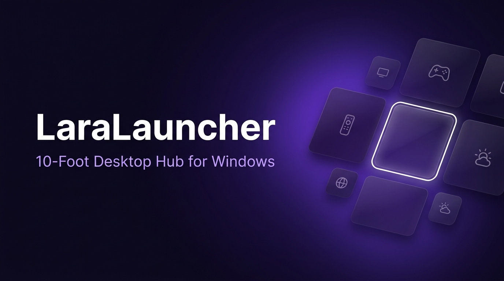
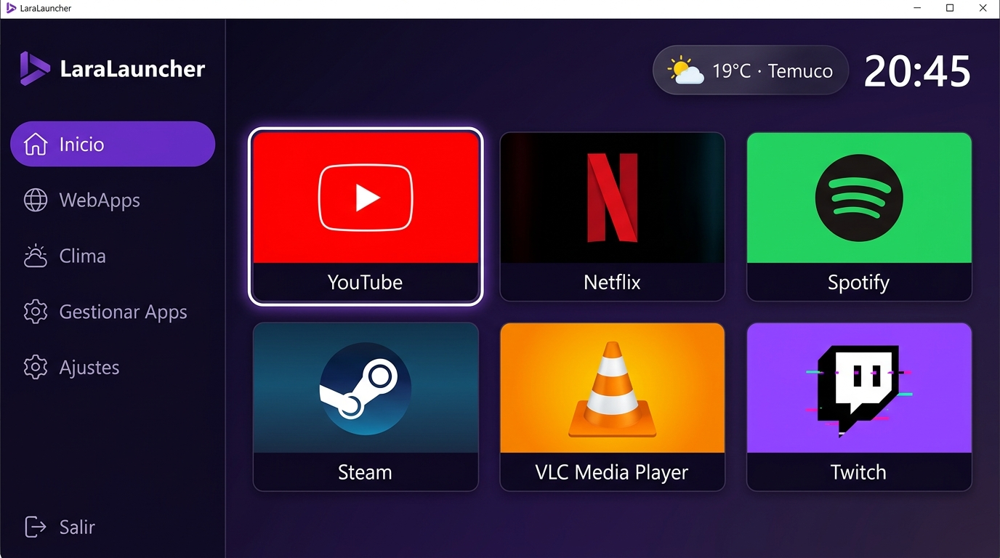
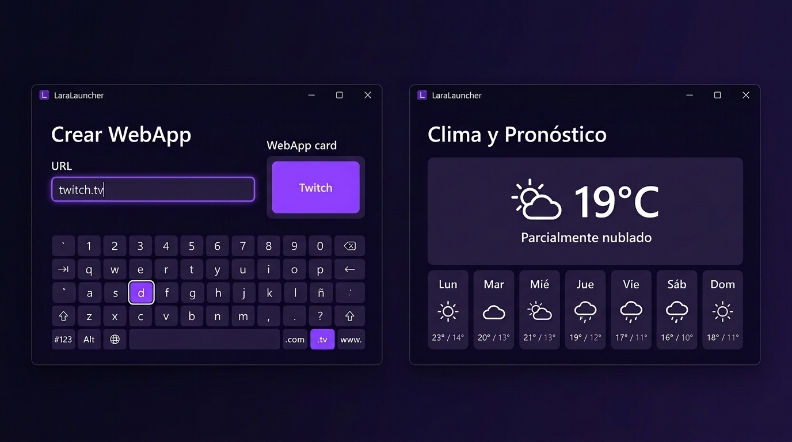
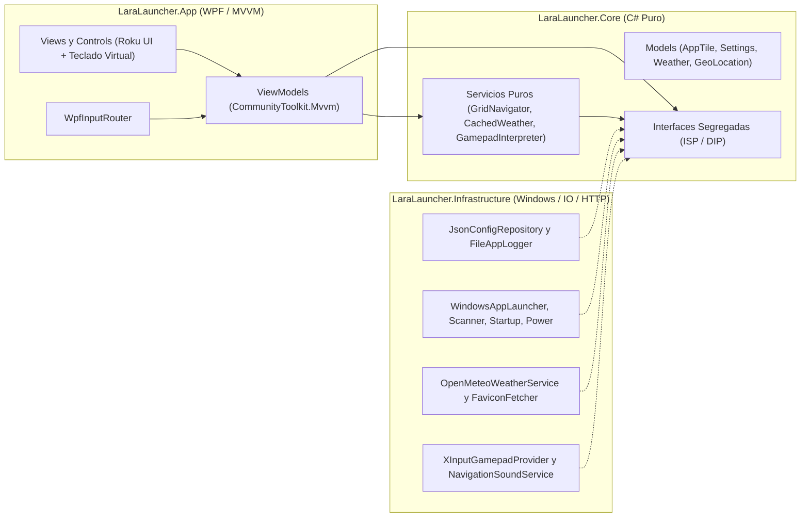

<div align="center">



# LaraLauncher

**Launcher de escritorio 10-Foot estilo Roku / Flex Launcher para Windows, construido en C# (WPF / .NET 8) bajo principios SOLID y KISS.**

[](https://dotnet.microsoft.com/)
[](#)
[](#)
[](#arquitectura-solid--kiss)
[](#desarrollo-y-pruebas)

[Características](#-características-principales) •
[Vistas Previas](#-vistas-previas) •
[Controles](#-controles-y-navegación) •
[Arquitectura](#-arquitectura-solid--kiss) •
[Instalación](#-instalación-y-empaquetado) •
[Desarrollo](#-desarrollo-y-pruebas)

</div>

---

## ✨ Características Principales

- **📺 Interfaz 10-Foot estilo Roku:** Menú lateral oscuro, tarjetas horizontales con foco de alto contraste y zoom animado, barra de ventana negra nativa (`DwmSetWindowAttribute`), reloj en vivo y sonidos sutiles sintetizados en memoria (desactivables).
- **🖱️ Gestión 100% Gráfica (cero edición manual de archivos):** Escanea automáticamente las aplicaciones instaladas en el Menú Inicio de Windows, extrae sus íconos en caché PNG y permite marcar/desmarcar qué apps aparecen en Inicio, añadir `.exe` / `.lnk` manualmente, editar nombre/categoría/color y **reordenar tarjetas visualmente** con el control remoto o teclado.
- **🌐 Creador de WebApps + Teclado Virtual 5×10:** Convierte cualquier sitio web (`youtube.com`, `netflix.com`, `twitch.tv`, servidores locales, etc.) en una tarjeta de Inicio que se abre en tu navegador por defecto, con descarga automática de favicon y un **teclado virtual integrado** con atajos URL (`www.`, `.com`, `.cl`, `.tv`) operable totalmente con control remoto o gamepad.
- **⛅ Clima Actual y Pronóstico de 7 Días:** Integración gratuita y sin API Key con **Open-Meteo** (clima actual, sensación térmica, humedad, viento, pronóstico de los próximos días y buscador gráfico de ciudad), con caché local en disco (TTL de 30 min) y respaldo automático *offline*.
- **🎮 Teclado, Control Remoto y Gamepad (XInput):** Enrutador unificado de entrada para teclado, controles remotos IR/RF/Air Mouse/CEC y mandos **XInput** (D-Pad, stick izquierdo con *deadzone* y auto-repetición suave). El polling del mando se pausa automáticamente al abrir juegos o perder foco.
- **🚀 Listo para Uso Diario:** Arranque automático con Windows por usuario (`HKCU\...\Run` sin privilegios de administrador), recuperación automática de foco al cerrar una app lanzada, instancia única (`Mutex`), logging rotativo de 7 días e instalador **Inno Setup 6**.

---

## 🖼️ Vistas Previas

### Pantalla de Inicio (Grilla 10-Foot estilo Roku)
<div align="center">
  
</div>

### Creador de WebApps con Teclado Virtual y Pronóstico de 7 Días
<div align="center">
  
</div>

---

## 🎮 Controles y Navegación

Toda la aplicación (Inicio, WebApps, Teclado Virtual, Clima, Gestor de Apps, Ajustes y Diálogos de Energía) está diseñada para operarse **sin tocar el mouse**:

| Acción | Teclado / Control Remoto (IR · RF · CEC) | Mando / Gamepad (XInput) |
| :--- | :--- | :--- |
| **Navegar** | `↑` `↓` `←` `→` | `D-Pad` o `Stick Izquierdo` |
| **Abrir / Seleccionar** | `Enter` / `Espacio` | Botón `A` |
| **Atrás / Volver al menú lateral** | `Esc` / `Backspace` / `BrowserBack` | Botón `B` |
| **Opciones de tarjeta** *(Mover · Editar · Quitar)* | `M` / Tecla `Menú` / `Clic derecho` | Botón `Y` o `Start` |
| **Volver directo a Inicio** | `Home` / `BrowserHome` | Botón `Back` |
| **Alternar Pantalla Completa / Ventana** | `F11` | *(desde Ajustes)* |

---

## 🏛️ Arquitectura (SOLID + KISS)

La solución mantiene **3 proyectos de producción + 1 de pruebas** con fronteras claras y sin sobre-ingeniería:



### Principios aplicados en el código
- **SRP (Responsabilidad Única):** Escaneo de apps (`WindowsInstalledAppsScanner`), caché de íconos (`IconCacheService`), construcción de procesos (`AppLaunchInfoBuilder`) y estado de mando (`GamepadStateInterpreter`) viven separados y enfocados.
- **OCP (Abierto/Cerrado):** Nuevos dispositivos de entrada se agregan implementando `IInputProvider`, y el caché de clima decora `IWeatherService` vía `CachedWeatherService`.
- **ISP & DIP:** `LaraLauncher.Core` no tiene dependencias de WPF ni Win32; todos los ViewModels dependen de interfaces pequeñas cableadas en `App.xaml.cs`.
- **KISS:** Persistencia atómica en JSON (`%AppData%\LaraLauncher\`), cero motores SQL pesados, P/Invoke directo y liviano para XInput/DWM/Audio.

### Estructura del Repositorio

```text
LaraLauncher/
├── LaraLauncher.sln
├── docs/images/                      # Recursos visuales del README
├── installer/setup.iss               # Script de instalador Inno Setup 6
├── scripts/build-release.ps1         # Pipeline Release (Tests + Publish + Setup)
├── src/
│   ├── LaraLauncher.Core/            # Dominio puro, interfaces y lógica testeable
│   ├── LaraLauncher.Infrastructure/  # Windows, JSON atómico, Open-Meteo, XInput, Audio
│   └── LaraLauncher.App/             # WPF, RokuTheme, Controls, Views y ViewModels
└── tests/
    └── LaraLauncher.Tests/           # 58 pruebas unitarias con xUnit
```

---

## 📦 Instalación y Empaquetado

### Requisitos previos
- **Windows 10 / 11 (x64)**
- [.NET 8 SDK](https://dotnet.microsoft.com/download/dotnet/8.0) *(solo para compilar; el paquete publicado es autocontenido)*
- *(Opcional)* [Inno Setup 6](https://jrsoftware.org/isinfo.php) para generar el instalador `.exe`:
  ```powershell
  winget install --id JRSoftware.InnoSetup --exact
  ```

### Compilar versión Release e instalador en 1 paso
```powershell
.\scripts\build-release.ps1
```
El script ejecuta:
1. Toda la suite de pruebas unitarias en modo `Release`.
2. Publicación autocontenida `win-x64` en `publish\win-x64\LaraLauncher.exe`.
3. Compilación automática de `installer\Output\LaraLauncherSetup-1.0.0.exe` (incluye casilla para iniciar automáticamente con Windows).

---

## 🛠️ Desarrollo y Pruebas

```powershell
# Ejecutar en modo ventana (recomendado para desarrollo; F11 pasa a pantalla completa)
dotnet run --project src\LaraLauncher.App -- --windowed

# Ejecutar directamente en pantalla completa (modo TV)
dotnet run --project src\LaraLauncher.App

# Ejecutar todas las pruebas unitarias
dotnet test LaraLauncher.sln -c Release
```

### Datos locales (gestionados automáticamente por la app)
Todos los datos del usuario se almacenan en `%AppData%\LaraLauncher\`:
- `config.json` — Tarjetas, WebApps y preferencias (escritura atómica con respaldo automático ante corrupción).
- `icons\` — Caché PNG de íconos extraídos de Windows y favicons de WebApps.
- `cache\weather-cache.json` — Caché local del pronóstico de 7 días para arranque instantáneo y soporte *offline*.
- `logs\` — Logs diarios con rotación automática de 7 días.

---

<div align="center">
<sub>Hecho con C#, WPF y .NET 8 — Diseñado para disfrutarse desde el sofá.</sub>
</div>
