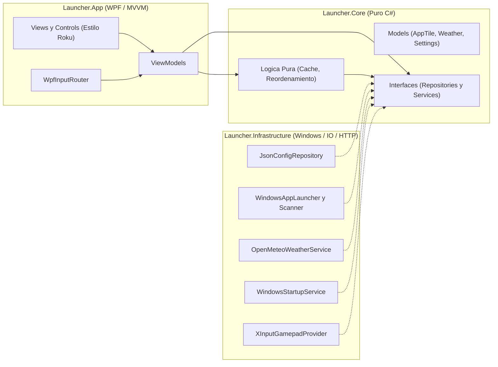

# Plan de Implementación — LaraLauncher (Desktop Launcher Estilo Roku en C#)

Plan técnico e incremental para desarrollar **LaraLauncher**, un launcher de escritorio tipo **Flex Launcher** con estética **Roku** (interfaz *10-foot UI* optimizada para TV/monitor a distancia), instalable en Windows, con arranque automático, gestión 100% gráfica de aplicaciones, clima actual y pronóstico extendido, construido en **WPF (.NET 8)** bajo principios **SOLID** y **KISS**.

> [!NOTE]
> Decisiones confirmadas: nombre **LaraLauncher**, interfaz **WPF (.NET 8)**, tarjetas horizontales simples estilo Roku (ícono centrado + fondo oscuro limpio + título) y compatibilidad con teclado, controles remotos y gamepads.

---

## 1. Decisiones Técnicas y Stack Recomendado

| Área | Elección Recomendada | Justificación (KISS + Eficiencia) |
| :--- | :--- | :--- |
| **Plataforma** | **.NET 8 (LTS)** | Soporte a largo plazo, excelente rendimiento y despliegue autocontenido (*self-contained*). |
| **Framework UI** | **WPF (Windows Presentation Foundation)** | Aceleración por hardware (DirectX), control fino del foco de teclado/mando, animaciones suaves a 60 FPS y acceso directo a Win32 (íconos de `.exe`/`.lnk`, registro, XInput) sin restricciones de sandbox MSIX. |
| **Patrón UI** | **MVVM** con `CommunityToolkit.Mvvm` | Generadores de código (`[ObservableProperty]`, `[RelayCommand]`) que eliminan *boilerplate* y mantienen los ViewModels limpios. |
| **DI / IoC** | `Microsoft.Extensions.DependencyInjection` | Contenedor estándar, liviano y suficiente para invertir dependencias sin complejidad extra. |
| **Persistencia** | `System.Text.Json` en `%AppData%\RokuLauncher\` | Sin motores de BD externos. Escritura atómica (archivo temporal + reemplazo) para evitar corrupción ante cortes de energía. **El usuario nunca edita archivos manualmente.** |
| **API de Clima** | **Open-Meteo** (Forecast + Geocoding) | Gratuita, rápida, sin API Key obligatoria, soporta pronóstico de 5–7 días y búsqueda de ciudades por nombre. Con caché local para arranque instantáneo y soporte *offline*. |
| **Controles / Mandos** | Teclado/IR/CEC nativo + **XInput** (P/Invoke liviano) | Controles remotos IR/RF/Air Mouse funcionan vía teclas estándar; mandos Xbox/genéricos vía P/Invoke directo a `xinput1_4.dll` (~80 líneas, cero dependencias pesadas). |
| **Instalador** | **Inno Setup** sobre `dotnet publish` | Genera un instalador `.exe` clásico de Windows, ligero, con opción de autostart y desinstalador limpio. |

> [!TIP]
> **Alternativa multiplataforma:** Si a futuro quisieras ejecutar el launcher también en Linux (HTPC/SteamOS), **Avalonia UI** sería el sustituto natural de WPF. Como toda la lógica y los contratos vivirán en `Launcher.Core`, cambiar la capa visual no requeriría reescribir el negocio.

---

## 2. Arquitectura SOLID y KISS

La solución se divide en **3 proyectos de producción + 1 de pruebas**. Se evitan capas redundantes (KISS), pero se mantienen fronteras claras entre negocio, infraestructura de Windows y presentación (SOLID).



### Aplicación concreta de SOLID y KISS

- **S (Single Responsibility):** Cada clase tiene una razón de cambio: `WindowsInstalledAppsScanner` solo descubre apps y extrae íconos; `WindowsAppLauncherService` solo lanza procesos y recupera el foco; `JsonConfigRepository` solo persiste y lee JSON.
- **O (Open/Closed):**
  - El soporte de entrada usa `IInputProvider` y acciones semánticas (`NavigationAction`: `Up`, `Down`, `Left`, `Right`, `Select`, `Back`, `ContextMenu`). Sumar un nuevo control remoto (ej. HDMI-CEC o HID específico) implica agregar un nuevo proveedor sin tocar vistas ni ViewModels.
  - El caché de clima se implementa como *Decorator* (`CachedWeatherService` envolviendo `IWeatherService`).
- **L (Liskov Substitution):** Cualquier `IAppLauncherService` (ej. un *mock* en pruebas o implementaciones para `.exe`/UWP) cumple el mismo contrato de ejecución y notificación de cierre.
- **I (Interface Segregation):** Interfaces pequeñas y enfocadas (`IWeatherService`, `ILocationSearchService`, `IStartupService`, `IConfigRepository`, `IInstalledAppsScanner`) en lugar de un único `ISystemService` monolítico.
- **D (Dependency Inversion):** Los ViewModels dependen exclusivamente de interfaces definidas en `Launcher.Core`; el cableado real ocurre únicamente en `App.xaml.cs`.
- **KISS:** Sin bases de datos SQL, sin *Event Bus* complejo, sin frameworks de plugins prematuros. Solo lo necesario para que sea rápido, estable y fácil de mantener.

### Estructura de Carpetas Propuesta

```text
c:\Desarrollos\Launcher\
├── RokuLauncher.sln
├── src\
│   ├── Launcher.Core\
│   │   ├── Models\            # AppTile, AppCategory, LauncherSettings, WeatherForecast, NavigationAction
│   │   ├── Interfaces\        # IConfigRepository, IAppLauncherService, IInstalledAppsScanner, IWeatherService, etc.
│   │   └── Services\          # CachedWeatherService, AppCatalogCoordinator
│   ├── Launcher.Infrastructure\
│   │   ├── Persistence\       # JsonConfigRepository, IconCacheStore
│   │   ├── Windows\           # WindowsAppLauncherService, WindowsInstalledAppsScanner, WindowsStartupService
│   │   ├── Weather\           # OpenMeteoWeatherService, WmoWeatherMapper
│   │   └── Input\             # XInputGamepadProvider
│   └── Launcher.App\
│       ├── Themes\            # Colores Roku, estilos de foco, animaciones, tipografia 10-foot
│       ├── Controls\          # AppTileCard, FocusAdorner, SidebarNav, WeatherHeaderWidget
│       ├── Views\             # HomeView, WeatherDetailView, AppManagerView, SettingsView
│       ├── ViewModels\        # MainViewModel, HomeViewModel, WeatherViewModel, AppManagerViewModel, SettingsViewModel
│       ├── Input\             # WpfInputRouter
│       └── App.xaml.cs        # Composition Root (DI)
├── tests\
│   └── Launcher.Tests\        # Pruebas unitarias con xUnit
└── installer\
    └── setup.iss              # Script de Inno Setup
```

---

## 3. Plan de Implementación por Fases Manejables

Cada fase produce una versión **compilable y ejecutable** que puede probarse de inmediato antes de pasar a la siguiente.

### Fase 0 — Entorno y Esqueleto de la Solución
**Objetivo:** Dejar la solución creada, compilando y con la infraestructura de DI y estilos base lista.
- [ ] Verificar/instalar **.NET 8 SDK** en el equipo y confirmar `dotnet --version`.
- [ ] Crear `RokuLauncher.sln` y los 4 proyectos (`Launcher.Core`, `Launcher.Infrastructure`, `Launcher.App`, `Launcher.Tests`) con sus referencias correctas (`App` → `Core` + `Infrastructure`; `Infrastructure` → `Core`).
- [ ] Instalar paquetes mínimos: `CommunityToolkit.Mvvm` y `Microsoft.Extensions.DependencyInjection` (y `xunit` en tests).
- [ ] Configurar `App.xaml.cs` como *Composition Root* y crear la ventana principal (`MainWindow`) sin bordes en pantalla completa (con tecla `F11` o parámetro `--windowed` para depurar cómodamente).
- **Criterio de terminado:** `dotnet build` y `dotnet test` pasan; al ejecutar `Launcher.App` abre una ventana fullscreen con fondo oscuro degradado estilo Roku.

---

### Fase 1 — Shell Estilo Roku y Navegación Unificada (Teclado + Control Remoto)
**Objetivo:** Lograr la experiencia visual y de navegación *10-foot* estilo Roku antes de conectar datos reales.
- [ ] Diseñar el *layout* principal tipo Roku:
  - **Sidebar izquierdo:** Inicio, Clima, Gestionar Apps, Ajustes, Salir/Energía.
  - **Cabecera superior derecha:** Reloj en vivo + espacio reservado para el widget de clima.
  - **Área central derecha:** Grilla de tarjetas grandes (`AppTileCard`) con datos de prueba (*mock*).
- [ ] Crear estilos de foco estilo Roku:
  - Borde luminoso de alto contraste (morado/blanco configurable), leve aumento de escala (`ScaleTransform` animado a ~1.06x) y desplazamiento automático del scroll para mantener el ítem enfocado siempre visible.
- [ ] Implementar `NavigationAction` y `WpfInputRouter`:
  - Mapear Flechas, `Enter`/`Space`, `Escape`/`Backspace`/`BrowserBack` (botón Back de controles remotos), `Apps`/`Menu` (menú contextual) y `Home`.
  - Garantizar navegación fluida **Sidebar ↔ Grilla** sin jamás perder el foco ni requerir el mouse.
- **Criterio de terminado:** Puedes recorrer todo el menú lateral y una grilla de prueba únicamente con teclado o control remoto IR/RF, con foco claro y fluido.

---

### Fase 2 — Persistencia JSON, Modelo de Apps y Lanzador de Procesos
**Objetivo:** Reemplazar los datos de prueba por aplicaciones reales que se ejecutan y devuelven el control al launcher.
- [ ] Definir `AppTile` (`Id`, `Name`, `ExecutablePath`, `Arguments`, `IconPath`, `Category`, `Order`, `LaunchType`: `Executable`, `Shortcut`, `Uwp`, `Uri`) y `LauncherSettings`.
- [ ] Implementar `JsonConfigRepository` con escritura atómica (`config.tmp` → `File.Move(..., overwrite: true)`) en `%AppData%\RokuLauncher\config.json`.
- [ ] Implementar `WindowsAppLauncherService`:
  - Lanzar `.exe`, `.lnk`, URIs (`steam://...`, `https://...`) y apps de Microsoft Store (`shell:AppsFolder\...`).
  - Minimizar u ocultar temporalmente el launcher (o ceder foco) al abrir la app y **recuperar el foco automáticamente** cuando el proceso lanzado termine (con manejo seguro para apps que delegan a otro proceso, como navegadores o launchers de juegos).
- [ ] Diseñar un estado vacío amigable en Inicio cuando aún no hay apps configuradas, con botón directo a "Agregar aplicaciones".
- **Criterio de terminado:** Una app configurada en el JSON se muestra en la grilla, se ejecuta al presionar `Enter` y al cerrarla el usuario vuelve al launcher con el foco intacto.

---

### Fase 3 — Gestión Gráfica de Aplicaciones (Sin Editar Archivos)
**Objetivo:** Permitir agregar, quitar, editar y reordenar aplicaciones 100% desde la interfaz gráfica usando teclado/mando o mouse.
- [ ] Implementar `WindowsInstalledAppsScanner`:
  - Escanear accesos directos del Menú Inicio (usuario + todos los usuarios) y aplicaciones instaladas relevantes, filtrando desinstaladores y entradas basura.
  - Extraer íconos de alta resolución y guardarlos en caché local (`%AppData%\RokuLauncher\icons\`) como PNG para carga instantánea.
- [ ] Crear `AppManagerView` (navegable con teclado/mando):
  - **Modo Catálogo / Checklist:** Lista visual de aplicaciones detectadas en Windows con barra de filtro rápido y casillas visuales para marcar/desmarcar qué apps aparecen en el launcher.
  - **Agregar manualmente:** Botón para seleccionar cualquier `.exe`, `.lnk` o URL/app personalizada mediante selector de archivo.
  - **Edición rápida de Tile:** Cambiar nombre visible, elegir ícono/imagen personalizada (banner estilo Roku 16:9 o ícono centrado sobre color de fondo) y asignar categoría.
  - **Reordenamiento visual:** Desde la grilla (menú contextual con botón `Menu` o tecla `M`/`ContextMenu`), activar modo "Mover" para reubicar una tarjeta con las flechas y confirmar con `Enter`, o eliminarla con confirmación.
- **Criterio de terminado:** Puedes abrir el launcher vacío, descubrir tus apps instaladas gráficamente, marcar 5–6 apps, reordenarlas y personalizar sus nombres sin abrir jamás un editor de texto.

---

### Fase 4 — Clima Actual y Pronóstico de los Próximos Días
**Objetivo:** Integrar información meteorológica confiable y legible a distancia.
- [ ] Implementar `OpenMeteoWeatherService` (`ILocationSearchService` + `IWeatherService`) con `HttpClient`:
  - Clima actual: temperatura, sensación térmica, condición (código WMO mapeado a texto en español e ícono vectorial limpio) y humedad/viento.
  - Pronóstico extendido: próximos **5 a 7 días** (día de la semana, ícono, temperatura máxima/mínima y probabilidad de precipitación).
- [ ] Implementar `CachedWeatherService` (Decorator):
  - Caché en memoria y disco (`weather-cache.json`) con TTL configurable (ej. 30 minutos).
  - Si no hay internet, muestra los últimos datos cacheados con un indicador discreto de última actualización, sin bloquear ni romper la UI.
- [ ] Integrar en la UI:
  - **Widget de cabecera:** Temperatura actual + ícono junto al reloj en la pantalla principal.
  - **Vista de Clima (`WeatherDetailView`):** Accesible desde el Sidebar (o seleccionando el widget), mostrando clima actual destacado arriba y una fila horizontal de tarjetas grandes para los próximos días.
  - **Selector gráfico de ciudad:** Buscador de ciudad por nombre (usando Open-Meteo Geocoding) dentro de Ajustes o en la propia vista de Clima.
- **Criterio de terminado:** Al elegir tu ciudad desde la UI, el header muestra el clima actual y la vista de Clima despliega el pronóstico de los próximos días, manteniéndose usable sin conexión gracias al caché.

---

### Fase 5 — Soporte de Mandos (Gamepad XInput) y Ajustes del Sistema
**Objetivo:** Completar la experiencia de sofá/control remoto y habilitar el arranque con Windows desde la UI.
- [ ] Implementar `XInputGamepadProvider`:
  - Polling ligero (~60Hz solo cuando la ventana está en primer plano; se pausa al lanzar un juego/app para no interferir con él).
  - Mapeo intuitivo: `D-Pad` y `Left Stick` (con *deadzone* y repetición suave) → Navegación; `A` → Seleccionar; `B` → Atrás; `X`/`Y`/`Start` → Menú contextual de la app (Mover/Editar/Quitar).
- [ ] Implementar `WindowsStartupService`:
  - Leer, activar y desactivar la clave `HKCU\Software\Microsoft\Windows\CurrentVersion\Run` apuntando al ejecutable instalado (sin requerir privilegios de administrador).
- [ ] Construir `SettingsView`:
  - Toggle **Iniciar al arrancar Windows**.
  - Configuración de **Ciudad y Unidades** (°C / °F).
  - **Apariencia estilo Roku:** Color de acento / tema de fondo y tamaño de tarjetas (Compacto / Normal / Grande para TV).
  - Toggle de **Soporte Gamepad** y **Sonidos de navegación**.
  - Menú de **Energía / Sistema** (opcional y con confirmación): Salir al escritorio, Suspender, Reiniciar, Apagar.
- **Criterio de terminado:** Puedes controlar todo el launcher con un mando Xbox/compatible, activar el arranque automático desde Ajustes y verificar que la entrada se crea correctamente en el registro de usuario.

---

### Fase 6 — Pulido *10-Foot*, Pruebas Unitarias e Instalador de Windows
**Objetivo:** Dejar la aplicación lista para instalar y usar a diario de forma estable.
- [ ] **Pulido UX:**
  - Transiciones suaves entre vistas y sonidos sutiles de navegación (estilo Roku, desactivables).
  - Manejo global de excepciones no controladas + log rotativo liviano en `%AppData%\RokuLauncher\logs\`.
  - Soporte para instancia única (*Single Instance* vía `Mutex`): si se intenta abrir otra vez, simplemente trae al frente la ventana existente.
- [ ] **Pruebas Automatizadas (`Launcher.Tests`):**
  - Persistencia atómica y carga ante JSON corrupto/faltante.
  - Mapeo de respuestas Open-Meteo, códigos WMO y comportamiento de expiración/fallback de `CachedWeatherService`.
  - Reordenamiento, alta/baja y filtrado en el catálogo de apps.
- [ ] **Empaquetado e Instalador:**
  - Configurar perfil de publicación `dotnet publish -c Release -r win-x64 --self-contained true` (o *framework-dependent* si se prefiere menor tamaño).
  - Crear `installer\setup.iss` para **Inno Setup**: instala en `Program Files` (o `%LocalAppData%`), crea acceso directo en Menú Inicio, incluye casilla opcional *"Iniciar automáticamente con Windows"* y limpia las claves al desinstalar.
- **Criterio de terminado:** Se genera un instalador `RokuLauncherSetup.exe` funcional que instala la app, la registra para arrancar con Windows (si se marca) y pasa toda la suite de tests.

---

## 4. Verificación Recomendada por Hito

1. **Pruebas automatizadas:** Ejecutar `dotnet test` al cierre de cada fase con cobertura sobre `Launcher.Core` y servicios clave de `Launcher.Infrastructure`.
2. **Prueba *Solo Teclado / Control Remoto*:** Desconectar o no tocar el mouse durante 2 minutos y verificar que **todas** las pantallas (Inicio, Agregar Apps, Editar, Reordenar, Clima, Ajustes) son 100% operables sin quedarse nunca sin foco.
3. **Prueba de Ciclo de App:** Lanzar una app tradicional (ej. Notepad/VLC), una app moderna/navegador y un juego, cerrarlos y comprobar que el foco regresa al launcher y que el polling de XInput se pausa mientras la app externa corre.
4. **Prueba de Instalación y Autostart:** Instalar con el `.exe` generado, reiniciar sesión de Windows y verificar que el launcher arranca automáticamente, carga el caché de clima al instante y actualiza en segundo plano.

---

## 5. Puntos a Confirmar Antes de Comenzar la Fase 0

1. **Framework UI:** ¿Confirmamos **WPF (.NET 8)** orientado 100% a Windows, o te interesa portabilidad futura a Linux con **Avalonia UI**?
2. **Tipo de control remoto principal:** Además del teclado, ¿usarás un control remoto IR/RF/Air Mouse, un mando Xbox/gamepad, o ambos?
3. **Estética Roku:** ¿Prefieres tarjetas rectangulares horizontales (16:9 tipo canales Roku/Netflix) o cuadradas, y un tema oscuro tipo Roku (morado profundo/grafito) como predeterminado?
